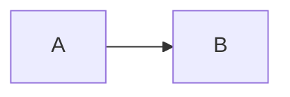
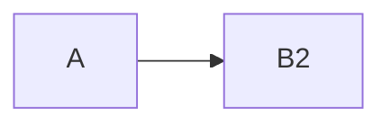

# שירותים, תהליכים ודאטה: REQ-___

> ⚠️ <אם יש פער מול הגודל הגס, ציין כאן>

## תהליך עסקי
**As‑Is:**

**To‑Be:**

## שירותים ומערכות מושפעים
| שירות | צוות בעלים | קיים / משתנה / חדש | רמת שינוי | מקור הידיעה |
|-------|------------|--------------------|-----------|-------------|

## ממשקים
| ממשק | סוג (קיים לשימוש חוזר / שינוי / חדש / חיצוני) | הערות |
|------|-----------------------------------------------|-------|

## נתונים
| ישות / שדה | פעולה (חדש / שינוי / קיים) | מקור אמת | רגיש (PII)? | הגירה נדרשת? |
|------------|-----------------------------|----------|-------------|---------------|

## השפעות רוחב
<דוחות, BI, ניטור, הרשאות, downstream>

## סיכונים טכניים
| סיכון | השפעה | הצעה לצמצום |
|-------|-------|-------------|

## שאלות פתוחות
| # | שאלה | למי | חוסמת? |
|---|------|-----|--------|
