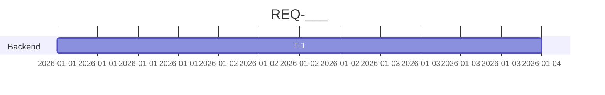

# לו"ז: REQ-___

## תאריכים
| | תאריך |
|---|-------|
| יעד (סביר) | |
| מחויבות (P80) | |
| מועד קשיח (אם יש) | |

## אבני דרך
| אבן דרך | תאריך יעד | תנאי סיום |
|---------|-----------|-----------|
| סיום פיתוח | | |
| סיום QA/UAT | | |
| עלייה לייצור | | |

## Gantt

## נתיב קריטי
T‑_ → T‑_ → ...

## הנחות קיבולת
| צוות / משאב | זמינות | הערות (חופשות, חגים) |
|-------------|--------|-----------------------|

## תלויות חיצוניות
| תלות | גורם | נדרש עד | סיכון |
|------|------|---------|-------|

## אפשרויות (אם המועד הקשיח לא עומד)
1. צמצום היקף: ...
2. הוספת משאב: ...
3. שלביות: ...
